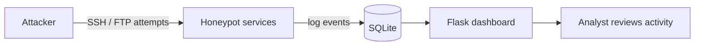
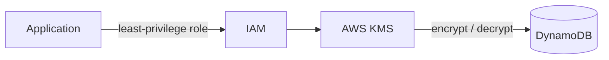

<div align="center">


<a href="https://git.io/typing-svg">
  
</a>

<br/><br/>


<a href="https://linkedin.com/in/choolan-jananjana"></a>
<a href="https://twitter.com/choolanjananja1"></a>

</div>


## `>_ whoami`

```bash
$ whoami
choolan_jananjana

$ cat profile.conf
focus       = "Digital Trust, Privacy & Information Security"
specialty   = "Cloud security, IAM & data encryption"
labs        = "Kali | Metasploit | Nmap | Wireshark"
certified   = "Google Cybersecurity | DFIR | ISO/IEC 27001"
status      = "Open to internships & collaboration"

$ cat interests.txt
- cloud security: AWS IAM, least privilege, KMS encryption
- offensive labs: Kali, Metasploit, Nmap, Wireshark
- governance: ISO/IEC 27001, risk & compliance, AI governance
- defence: monitoring, alert investigation, incident response, DFIR

$ echo $FUN_FACT
the term "bug" comes from a real moth found in a computer in 1947
```

📫 **Contact:** [jchoolan@gmail.com](mailto:jchoolan@gmail.com)


## `>_ ls ./projects`

<table>
<tr>
<td width="50%" valign="top">

### 🧪 [01] Cybersecurity Homelab
`STATUS: ONLINE`


Isolated lab for recon, vulnerability assessment, exploitation and traffic analysis. Exploited vsftpd 2.3.4 (CVE-2011-2523) with Metasploit, analysed it in Wireshark and wrote remediation recommendations.

</td>
<td width="50%" valign="top">

### ☁️ [02] AWS KMS Encryption & IAM
`STATUS: ENCRYPTED`


Encryption pipeline protecting data stored in DynamoDB, with least-privilege IAM policies and access controls.

</td>
</tr>
<tr>
<td width="50%" valign="top">

### 🍯 [03] SSH/FTP Honeypot
`STATUS: LISTENING`


Fake SSH and FTP services that log unauthorised access attempts to SQLite and show activity on a Flask dashboard.

</td>
<td width="50%" valign="top">

### 🔑 [04] Secure TCP Auth System
`STATUS: HARDENED`


Multi-client TCP server with fork-based concurrency, salted SHA-256 password hashing, session tokens and inactivity timeouts.

</td>
</tr>
<tr>
<td width="50%" valign="top">

### 🤖 [05] AI Security Scanner
`STATUS: SCANNING`


CLI tool that scans Python source files for potential security flaws and reports them in the terminal.

</td>
<td width="50%" valign="top">

### 🚗 [06] Parking Management System
`STATUS: DEPLOYED`


Full-stack app delivered by a team I led, covering architecture, task delegation and milestones.

</td>
</tr>
</table>

<details>
<summary><b>🔍 [ trace ] honeypot data flow</b></summary>
<br/>



</details>

<details>
<summary><b>🔍 [ trace ] KMS encryption pipeline</b></summary>
<br/>



</details>


## `>_ cat ./arsenal`

<details open>
<summary><b>🔐 security</b></summary>
<br/>


`security monitoring` `alert investigation` `vulnerability assessment` `incident response` `digital forensics` `network security` `data protection`

</details>

<details>
<summary><b>💻 code</b></summary>
<br/>


</details>

<details>
<summary><b>🎨 design</b></summary>
<br/>


</details>


## `>_ cat ./credentials`

<details>
<summary><b>📜 certifications</b></summary>
<br/>

| Certification | Issuer | Year |
|---|---|---|
| Google Cybersecurity Certificate | Coursera | 2023 |
| Digital Forensics & Incident Response (DFIR) | InfoSecLabs | 2026 |
| Alert Investigation Specialist | InfoSecLabs | 2026 |
| ISO/IEC 27001 Information Security Management System | Alison | 2026 |

</details>

<details>
<summary><b>🕹️ training & simulations</b></summary>
<br/>

- BreachLab Ghost Track Operator Certification (2026)
- Mastercard Cybersecurity Job Simulation, Forage (2026)
- Deloitte Australia Cyber Job Simulation, Forage (2026)

</details>


## `>_ ./github_stats.sh`

<div align="center">


</div>


## `>_ ssh connect@choolan`

<div align="center">

<a href="https://linkedin.com/in/choolan-jananjana"></a>
<a href="https://twitter.com/choolanjananja1"></a>
<a href="https://instagram.com/choolan.jay"></a>
<a href="https://jchoolan258.showwcase.com"></a>
<a href="mailto:jchoolan@gmail.com"></a>

<br/><br/>

`[ connection closed ]`

</div>


